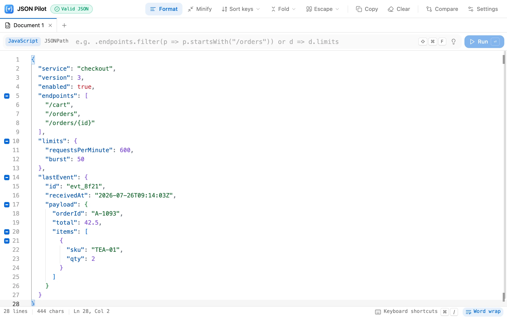

<div align="center">


# JSON Pilot

**The JSON workbench that runs in your browser.**<br />
Format, query, compare — and unfold the JSON hiding inside strings.

[Website](https://luckylight6.github.io/json-pilot/) · [Open the app](https://luckylight6.github.io/json-pilot/app/) · [Report an issue](https://github.com/LuckyLight6/json-pilot/issues) · [简体中文](README.zh-CN.md)

[](https://www.typescriptlang.org/)
[](https://react.dev/)
[](https://vite.dev/)
[](https://microsoft.github.io/monaco-editor/)
[](LICENSE)

<picture>
  <source media="(prefers-color-scheme: dark)" srcset="public/media/screenshot-en-dark.webp" />
  
</picture>

</div>

## Why JSON Pilot

Logs, message queues and webhooks love to stuff JSON *into strings*. Most viewers
stop at the first `"{\"orderId\":…}"`. JSON Pilot unfolds it into a real structure
with one click — and folds it back just as losslessly — inside a fast,
keyboard-first editor built on the same engine as VS Code.

Everything runs in the page. There is no server, no account and no analytics:
nothing you paste ever leaves the tab.

## Features

**Nested String Fold** — the headline feature

- A blue **⊞** in the gutter marks a string that holds a JSON object or array. Click it to parse the string into a real nested structure
- A blue **⊟** marks an object or array. Click it to collapse it back into a string value
- Round-trips are lossless and go through Monaco, so undo and redo keep working
- Markers sit left of the line numbers, so they never shift the text. They are deliberately not chevrons: Monaco's grey line-folding chevrons sit right next to them and do something different
- One marker per line — format a minified document first to reach the nested ones. Right-clicking anywhere inside a value offers the same toggle

**Editing and transforms**

- Monaco with JSON validation, bracket matching, folding and sticky scroll that keeps parent keys in view
- **JSONC throughout** — comments and trailing commas are accepted, and Format, Minify and Sort keys keep every comment. Only collapsing a structure back into a string drops the comments inside it: that string has to be strict JSON
- **Format / Minify** — Minify always gives one line, comments included: each comment is packed into a one-line block comment (`// note` becomes `/*// note*/`; a comment that had its own line is marked `\n`; line breaks inside a comment are escaped). Formatting that line unpacks them all, so you get back exactly what you had — only trailing commas, which carry nothing, are dropped. Minifying again changes nothing, and Format only unpacks one-line documents, so comments you wrote yourself are never touched
- **Sort keys** recursively, ascending or descending — each property carries its comments with it, and numbers and escapes stay exactly as written
- **Escape / Unescape** a whole document to and from a JSON string literal
- Live validation: the header badge counts errors and jumps to the first one

**Querying**

- **JSONPath** via [`jsonpath-plus`](https://github.com/JSONPath-Plus/JSONPath) — `$.store.book[*].author`, filters like `$.users[?(@.age > 30)]`. A path that names one value returns that value; a path that can fan out (`*`, `..`, `[?()]` filters, slices, unions) always returns a list — `[]` when nothing matches — so the result's shape never depends on how many items happen to match
- **JavaScript** against the document as `data` or `$` — an expression (`data.users.length`), a leading accessor (`.users[0].name`), a callback (`d => d.users.filter(u => u.active)`), or statements with an explicit `return`
- The 💡 menu in the query bar fills in examples that run against the sample document, and the query type is remembered
- Results open in a read-only editor showing the query and how many nodes matched, ready to copy or to continue in a new tab. `NaN`, `Infinity`, BigInts, Maps, Sets and circular references are shown as what they are rather than as `null` or `{}`

**Tabs and comparison**

- Several documents side by side in a tab strip — double-click renames, middle-click closes, right-click for more
- A comparison is its own tab, seeded from the active document. Both panes are editable; swap them, or send either side to a new tab

**Interface**

- Light and dark themes, English and 简体中文 — both follow the system until you choose otherwise
- Every action has a shortcut and every shortcut can be rebound (`Mod+/`)
- Toolbar menus open on hover; the toolbar shows icons and labels, icons only or labels only
- Right-click menus in the editor and in comparisons
- Every choice is remembered in `localStorage` under `json-pilot.*`; documents are not

## Keyboard shortcuts

Every command has a default, chosen to match the apps you already use:
document actions are `Alt+Shift+<letter>` chords (`⌥⇧` on macOS) — the shape
VS Code uses for Format, and clear of the `Mod`+letter keys Monaco and the
browser already own. Editor and view commands follow VS Code (`⌘K` chords,
`F8`, `⌥Z`). Press `Mod+/` in the app to see, search and rebind them all.

| Action | macOS | Windows / Linux |
|---|---|---|
| Format · Minify | `⌥⇧F` · `⌥⇧M` | `Alt+Shift+F` · `Alt+Shift+M` |
| Sort keys ascending · descending | `⌥⇧S` · `⌥⇧R` | `Alt+Shift+S` · `Alt+Shift+R` |
| Escape · Unescape | `⌥⇧E` · `⌥⇧U` | `Alt+Shift+E` · `Alt+Shift+U` |
| Copy document · Clear | `⌥⇧C` · `⌥⇧⌫` | `Alt+Shift+C` · `Alt+Shift+Backspace` |
| Load the sample document | `⌥⇧I` | `Alt+Shift+I` |
| Fold all · Unfold all | `⌘K ⌘0` · `⌘K ⌘J` | `Ctrl+K Ctrl+0` · `Ctrl+K Ctrl+J` |
| Jump to the first error | `F8` | `F8` |
| Focus the query box | `⌘⇧F` | `Ctrl+Shift+F` |
| New tab · Close tab | `⌘⌥N` · `⌘⌥W` | `Ctrl+Alt+N` · `Ctrl+Alt+W` |
| Next tab · Previous tab | `⌘⌥PgDn` · `⌘⌥PgUp` | `Ctrl+Alt+PgDn` · `Ctrl+Alt+PgUp` |
| New comparison · Swap sides | `⌘K D` · `⌥⇧X` | `Ctrl+K D` · `Alt+Shift+X` |
| Word wrap · Theme · Toolbar style | `⌥Z` · `⌘K ⌘T` · `⌥⇧B` | `Alt+Z` · `Ctrl+K Ctrl+T` · `Alt+Shift+B` |
| All shortcuts | `⌘/` | `Ctrl+/` |

A `⌘K` chord is two key presses in a row. Monaco's own `⌘K` chords — `⌘K ⌘C`
to comment, `⌘K ⌘U` to uncomment — keep working alongside them.

## Quick start

Requires Node.js 22+ and pnpm.

```bash
pnpm install
pnpm dev
```

`pnpm dev` serves the product site at <http://localhost:5173/> and the editor at
<http://localhost:5173/app/>.

| Command | What it does |
|---|---|
| `pnpm dev` | Start the dev server |
| `pnpm build` | Type-check and build both pages to `dist/` |
| `pnpm preview` | Serve the production build |
| `pnpm test` / `pnpm test:watch` | Run the unit tests once / in watch mode |
| `pnpm lint` | Run ESLint |
| `pnpm typecheck` | Type-check without building |
| `pnpm render:promo` | Render the site's intro films, every language × theme, to `public/media/promo-*.mp4` (needs Google Chrome) |
| `pnpm capture:screenshots` | Re-capture the editor screenshots (needs `pnpm dev` and Google Chrome) |
| `pnpm render:assets` | Re-render the touch/install icons and the social share card (needs Google Chrome) |

## The intro film

The 24-second film on the product site is a web page, not an edited video:
[`scripts/promo/`](scripts/promo/) lays out six scenes on one Web Animations
timeline cut to a 120 BPM grid, and every key press, click and cut lands on a
beat. There is one film per language and theme, and the site plays the one
that matches the page. Open `scripts/promo/promo.html` through `pnpm dev` to
scrub it (`?t=12.5`), switch language (`?lang=zh-CN`) or theme
(`?theme=light`), or play it with sound (`?play`).

The soundtrack is synthesised too — an original piece in A minor plus a sound
effect for every cue in the picture ([`music.js`](scripts/promo/music.js)) —
so there is nothing to license. `pnpm render:promo` seeks to every frame and
screenshots it in headless Chrome, encodes the frames to H.264 and the
soundtrack to AAC with WebCodecs, and writes the MP4 itself
([`scripts/lib/mp4.mjs`](scripts/lib/mp4.mjs)) — no ffmpeg required. To score
the film with a licensed track instead, pass `-- --music path/to/track.mp3`;
the sound effects are kept.

The video is H.264 at a constant quantizer rather than a bitrate target —
measured against the captured frames, that is visually lossless (≥ 46 dB PSNR
on every sampled frame) at about 8 MB per film. The site never autoplays it:
only the poster loads until the visitor presses play.

## Performance

Monaco is by far the largest dependency, so the editor is built to never wait for it:

- **Only JSON ships.** `monaco-editor` is aliased to [`monaco-json.ts`](src/components/monaco/monaco-json.ts), which registers the JSON language alone instead of ~80 grammars and the CSS, HTML and TypeScript services (−570 kB minified)
- **Monaco loads lazily.** Nothing outside [`components/monaco/`](src/components/monaco/) imports it at runtime; the store receives the API when the first editor mounts. The header, tabs, query bar and empty state paint first, and the editor streams in behind a loading bar
- **The site never loads the editor.** The product site and the editor are separate entries that share only React and the UI primitives
- **Transforms stay linear.** Minifying a 1 MB document takes about 50 ms; it used to rebuild the string once per whitespace token and took about 18 s
- **Keystrokes stay cheap.** The shortcut dispatcher looks chords up in a pre-built index instead of re-parsing the keymap on every key press

Measured on the production build — gzip, cold cache, headless Chrome, median of three loads:

| | 1.6 Mbps, 150 ms RTT | 10 Mbps, 40 ms RTT |
|---|---|---|
| Editor — first paint, before → after | 6.3 s → **1.2 s** | 1.5 s → **0.5 s** |
| Editor — ready to type, before → after | 6.3 s → 5.9 s | 1.7 s → 1.5 s |
| Product site — first paint | **1.2 s** (125 kB) | **0.3 s** |

Before, nothing at all was drawn until Monaco had fully arrived; now the editor's UI is usable at once while the editor itself loads.

## Project structure

```
index.html                      # Product site entry (/)
app/index.html                  # Editor entry (/app/)
scripts/
├── chrome.mjs                  # Tiny headless-Chrome driver shared by the scripts
├── promo/                      # The intro film: timeline, styles, soundtrack, encoders
├── lib/mp4.mjs                 # Minimal MP4 writer (H.264 + AAC)
├── render-promo.mjs            # Renders public/media/promo-*.mp4 from scripts/promo/
├── capture-screenshots.mjs     # Captures public/media/screenshot-*.webp from the dev server
└── render-assets.mjs           # Renders public/icons/* and public/og-image.png
public/
├── media/                      # Intro film, posters and editor screenshots
├── icons/                      # Touch and install icons, rendered from src/assets/icon.svg
├── manifest.webmanifest        # Lets browsers install JSON Pilot as an app
└── og-image.png                # Social share card
src/
├── main.tsx · App.tsx          # Editor: layout — header, tabs, query bar, workspace, status bar
├── site/                       # Product site: copy (en / zh-CN), sections, demo video
├── components/
│   ├── monaco/                 # Everything that knows about Monaco — and the only runtime importer
│   │   ├── lazy.tsx            # The lazy boundary: CodeEditor / DiffEditor behind Suspense
│   │   ├── monaco-json.ts      # Slim runtime entry: the editor plus the JSON language only
│   │   ├── setup.ts            # Workers, loader config, themes, JSONC diagnostics, unbound default keys
│   │   ├── themes.ts           # Light/dark themes cut from the design tokens
│   │   ├── options.ts          # Editor option presets
│   │   ├── code-editor.tsx     # Single-document editor
│   │   ├── diff-editor.tsx     # Comparison editor (uncontrolled panes)
│   │   └── fold-markers.ts     # Fold targets → Monaco decorations, and back
│   ├── ui/                     # shadcn/ui primitives
│   └── …                       # Header, tab strip, query bar, menus, dialogs, status bar
├── commands/registry.ts        # Every command, its label and its default binding
├── hooks/use-keybindings.ts    # Window-capture shortcut dispatcher
├── i18n/                       # Locale registry, provider, en / zh-CN messages
├── lib/
│   ├── json/                   # Pure domain logic — no React, no Monaco (unit-tested)
│   ├── shortcuts.ts            # Chord parsing, matching and display (pure)
│   ├── tabs.ts · text.ts       # Tab identity and titles; line counting (pure)
│   └── local-preference.ts     # Shared localStorage read/write for UI choices
├── store/                      # Editor state, keybinding overrides, view preferences
└── theme/                      # Theme context and the matching Monaco theme
```

### Architecture

Three layers, in dependency order:

1. **`lib/json/`** — pure functions over JSON source text. No React, no Monaco, no toasts. This is where most of the unit tests live.
2. **`store/editor-store.ts`** — holds document state, calls the pure functions, and drives Monaco through imperative handles kept outside the store, so attaching an editor never re-renders subscribers.
3. **`components/`** — presentation. Each component subscribes to the store with a selector rather than pulling the whole state.

Terminology and conventions used across the code live in [CONTEXT.md](CONTEXT.md).

## Deployment

The site is static. [`.github/workflows/ci.yml`](.github/workflows/ci.yml) lints,
tests and builds, then publishes `dist/` to GitHub Pages when run manually.
Asset URLs are relative, so the build works from any sub-path.

## Contributing

1. Fork and branch: `git checkout -b feature/amazing-feature`
2. Keep `pnpm lint`, `pnpm test` and `pnpm build` green
3. Add tests next to the module for anything in `lib/`
4. If you change what the editor looks like, re-capture the screenshots with `pnpm capture:screenshots`; if you change the icon, run `pnpm render:assets`
5. Open a pull request

## License

MIT — see [LICENSE](LICENSE).
