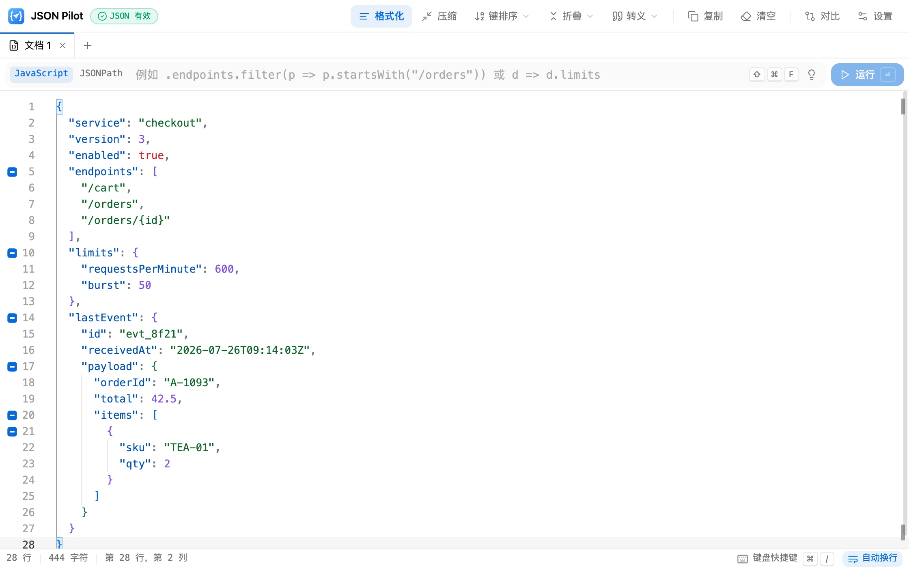

<div align="center">


# JSON Pilot

**在浏览器里运行的 JSON 工作台。**<br />
格式化、查询、对比——还能展开藏在字符串里的 JSON。

[官网](https://luckylight6.github.io/json-pilot/) · [打开应用](https://luckylight6.github.io/json-pilot/app/) · [反馈问题](https://github.com/LuckyLight6/json-pilot/issues) · [English](README.md)

[](https://www.typescriptlang.org/)
[](https://react.dev/)
[](https://vite.dev/)
[](https://microsoft.github.io/monaco-editor/)
[](LICENSE)

<picture>
  <source media="(prefers-color-scheme: dark)" srcset="public/media/screenshot-zh-CN-dark.webp" />
  
</picture>

</div>

## 为什么选择 JSON Pilot

日志、消息队列和 Webhook 总爱把 JSON **塞进字符串**里，大多数查看器看到
`"{\"orderId\":…}"` 就无能为力了。JSON Pilot 只需一次点击就能把它展开成真正的结构，
也能同样无损地收回去——这一切都发生在一个快速、键盘优先、与 VS Code 同内核的编辑器里。

所有处理都在页面内完成：没有服务器、没有账号、没有统计脚本，你粘贴的内容永远不会离开当前标签页。

## 功能

**嵌套字符串折叠**——核心功能

- 行号左侧的蓝色 **⊞** 表示该字符串里装着 JSON 对象或数组，点击即可解析为真正的嵌套结构
- 蓝色 **⊟** 表示一个对象或数组，点击即可折叠回字符串值
- 往返无损，并通过 Monaco 执行编辑，撤销 / 重做照常可用
- 标记位于行号左侧，编辑时不会挤动文本；刻意不用箭头形状，以便和 Monaco 自带的灰色代码折叠箭头区分
- 每行只显示一个标记——压缩过的文档请先格式化；在值内部右键也能执行同样的展开 / 折叠

**编辑与变换**

- 基于 Monaco：JSON 校验、括号匹配、代码折叠，以及让父级键名始终可见的粘性滚动
- **全面支持 JSONC**——注释和尾随逗号都能识别，格式化、压缩、键排序都会保留每一条注释。只有把结构折叠回字符串时会去掉其中的注释，因为这个字符串必须是严格的 JSON
- **格式化 / 压缩**——压缩结果始终是一行，注释也保留：每条注释都会打包成单行块注释（`// 注释` 变成 `/*// 注释*/`，原本独占一行的注释带 `\n` 标记，注释内部的换行会转义）；对这一行再格式化即可逐字恢复原文（只有不携带任何数据的尾随逗号会被去掉）。重复压缩不会再有变化；格式化只会展开单行文档，你自己写的注释不会被改动
- **键排序**：递归地升序或降序排列，每个属性连同它的注释一起移动，数字和转义写法原样保留
- **转义 / 反转义**：把整个文档转成 JSON 字符串字面量，或反向还原
- 实时校验：顶部徽章显示错误数量，点击即可跳到第一个错误

**查询**

- **JSONPath**，基于 [`jsonpath-plus`](https://github.com/JSONPath-Plus/JSONPath)——`$.store.book[*].author`，以及 `$.users[?(@.age > 30)]` 这样的过滤器。指向单个值的路径返回该值本身；可能匹配多个节点的路径（`*`、`..`、`[?()]` 过滤器、切片、联合）始终返回数组——没有匹配时为 `[]`——结果的形状不会随匹配数量变化
- **JavaScript**：文档以 `data` 或 `$` 提供——表达式（`data.users.length`）、以访问符开头（`.users[0].name`）、回调函数（`d => d.users.filter(u => u.active)`），或带显式 `return` 的多条语句
- 查询栏的 💡 菜单提供可直接用于示例文档的查询示例；查询类型会被记住
- 结果在只读编辑器中打开，并显示所执行的查询与匹配数量，可一键复制或另存为新标签页。`NaN`、`Infinity`、BigInt、Map、Set 与循环引用都会如实显示，而不是变成 `null` 或 `{}`

**标签页与对比**

- 多个文档并排打开：双击重命名、中键关闭、右键查看更多操作
- 对比是独立的标签页，以当前文档为左侧初始内容；两侧都可编辑，可交换左右，也能把任一侧另存为新标签页

**界面**

- 浅色 / 深色主题、English / 简体中文——在你主动选择之前都跟随系统
- 每个操作都有快捷键，每个快捷键都能自定义（`Mod+/`）
- 工具栏的下拉菜单鼠标移上去即展开；工具栏可显示图标加文字、仅图标或仅文字
- 编辑器与对比视图都有右键菜单
- 各项界面偏好保存在 `localStorage` 的 `json-pilot.*` 键下；文档内容不会被保存

## 键盘快捷键

每个命令都有默认快捷键，并尽量与常用软件保持一致：文档操作使用 `Alt+Shift+<字母>`
（macOS 上为 `⌥⇧`）——这正是 VS Code 格式化所用的组合，也避开了 Monaco 与浏览器已占用的
`Mod`+字母；编辑器与视图类命令沿用 VS Code 的习惯（`⌘K` 组合键、`F8`、`⌥Z`）。
在应用中按 `Mod+/` 可查看、搜索并修改全部快捷键。

| 操作 | macOS | Windows / Linux |
|---|---|---|
| 格式化 · 压缩 | `⌥⇧F` · `⌥⇧M` | `Alt+Shift+F` · `Alt+Shift+M` |
| 键升序 · 降序 | `⌥⇧S` · `⌥⇧R` | `Alt+Shift+S` · `Alt+Shift+R` |
| 转义 · 反转义 | `⌥⇧E` · `⌥⇧U` | `Alt+Shift+E` · `Alt+Shift+U` |
| 复制文档 · 清空 | `⌥⇧C` · `⌥⇧⌫` | `Alt+Shift+C` · `Alt+Shift+Backspace` |
| 载入示例文档 | `⌥⇧I` | `Alt+Shift+I` |
| 全部折叠 · 全部展开 | `⌘K ⌘0` · `⌘K ⌘J` | `Ctrl+K Ctrl+0` · `Ctrl+K Ctrl+J` |
| 跳到第一个错误 | `F8` | `F8` |
| 聚焦查询框 | `⌘⇧F` | `Ctrl+Shift+F` |
| 新建标签页 · 关闭标签页 | `⌘⌥N` · `⌘⌥W` | `Ctrl+Alt+N` · `Ctrl+Alt+W` |
| 下一个 · 上一个标签页 | `⌘⌥PgDn` · `⌘⌥PgUp` | `Ctrl+Alt+PgDn` · `Ctrl+Alt+PgUp` |
| 新建对比 · 交换左右 | `⌘K D` · `⌥⇧X` | `Ctrl+K D` · `Alt+Shift+X` |
| 自动换行 · 主题 · 工具栏样式 | `⌥Z` · `⌘K ⌘T` · `⌥⇧B` | `Alt+Z` · `Ctrl+K Ctrl+T` · `Alt+Shift+B` |
| 全部快捷键 | `⌘/` | `Ctrl+/` |

`⌘K` 组合键是先后按下的两次按键。Monaco 自带的 `⌘K` 组合键（`⌘K ⌘C` 注释、`⌘K ⌘U`
取消注释）照常可用。

## 快速开始

需要 Node.js 22+ 与 pnpm。

```bash
pnpm install
pnpm dev
```

`pnpm dev` 会在 <http://localhost:5173/> 提供官网，在 <http://localhost:5173/app/> 提供编辑器。

| 命令 | 作用 |
|---|---|
| `pnpm dev` | 启动开发服务器 |
| `pnpm build` | 类型检查并把两个页面构建到 `dist/` |
| `pnpm preview` | 预览生产构建 |
| `pnpm test` / `pnpm test:watch` | 运行单元测试（单次 / 监听） |
| `pnpm lint` | 运行 ESLint |
| `pnpm typecheck` | 仅做类型检查 |
| `pnpm render:promo` | 渲染官网介绍片（每种语言 × 主题各一版）到 `public/media/promo-*.mp4`（需安装 Google Chrome） |
| `pnpm capture:screenshots` | 重新截取编辑器截图（需先运行 `pnpm dev`，并安装 Google Chrome） |
| `pnpm render:assets` | 重新渲染触屏 / 安装图标与社交分享卡片（需安装 Google Chrome） |

## 介绍片

官网上 24 秒的介绍片本身就是一个网页，而不是剪辑出来的视频：[`scripts/promo/`](scripts/promo/)
把六个场景排在同一条 Web Animations 时间线上，按 120 BPM 的节拍切分，每次按键、点击和转场都踩在拍点上。
每种语言 × 浅色 / 深色各有一版，官网会播放与当前页面主题一致的那一版。
在 `pnpm dev` 下打开 `scripts/promo/promo.html` 即可预览：`?t=12.5` 定位到任意时刻，`?lang=zh-CN`
切换语言，`?theme=light` 切换浅色，`?play` 带声音播放。

配乐同样是合成的——一首 A 小调原创曲，外加与画面每个节点对应的音效（[`music.js`](scripts/promo/music.js)），
因此不涉及任何版权。`pnpm render:promo` 会在无头 Chrome 中逐帧定位并截图，用 WebCodecs 把画面编码为 H.264、
把配乐编码为 AAC，再由脚本自己写出 MP4（[`scripts/lib/mp4.mjs`](scripts/lib/mp4.mjs)），无需 ffmpeg。
如需改用已获授权的音乐，传入 `-- --music path/to/track.mp3` 即可，音效会保留。

视频采用固定量化参数（而非目标码率）的 H.264 编码：与原始帧对比实测，每个抽样帧的 PSNR 都不低于 46 dB，
肉眼无损，每段约 8 MB。官网不会自动播放：在访客点击播放之前，只加载封面图。

## 性能

Monaco 是体积最大的依赖，因此编辑器的设计原则是：永远不要等它。

- **只打包 JSON。** `monaco-editor` 被别名到 [`monaco-json.ts`](src/components/monaco/monaco-json.ts)，只注册 JSON 语言，而不是约 80 种语法外加 CSS、HTML、TypeScript 语言服务（压缩后减少 570 kB）
- **Monaco 懒加载。** 除 [`components/monaco/`](src/components/monaco/) 外没有任何运行时导入；store 在第一个编辑器挂载时才拿到 API。顶栏、标签页、查询栏和空状态先渲染，编辑器随后加载，期间显示进度条
- **官网从不加载编辑器。** 官网与编辑器是两个独立入口，只共享 React 与基础 UI 组件
- **变换保持线性复杂度。** 压缩 1 MB 文档约 50 ms；此前每遇到一个空白符号就重建一次整个字符串，需要约 18 秒
- **按键开销极低。** 快捷键分发器使用预先构建的索引查找组合键，不再在每次按键时重新解析整个键位表

生产构建实测（gzip、冷缓存、无头 Chrome，取三次加载的中位数）：

| | 1.6 Mbps，150 ms 往返 | 10 Mbps，40 ms 往返 |
|---|---|---|
| 编辑器首屏渲染（优化前 → 优化后） | 6.3 s → **1.2 s** | 1.5 s → **0.5 s** |
| 编辑器可输入（优化前 → 优化后） | 6.3 s → 5.9 s | 1.7 s → 1.5 s |
| 官网首屏 | **1.2 s**（125 kB） | **0.3 s** |

优化前，Monaco 完全下载之前页面一片空白；现在编辑器界面立即可用，编辑器本身在后台加载。

## 项目结构与架构

目录说明与三层架构（纯函数 `lib/json/` → 状态 `store/` → 展示 `components/`）详见
[英文 README](README.md#project-structure)，代码中使用的术语与约定见 [CONTEXT.md](CONTEXT.md)。

## 部署

本项目是纯静态站点。[`.github/workflows/ci.yml`](.github/workflows/ci.yml) 会依次执行 lint、测试、构建，
手动触发时把 `dist/` 发布到 GitHub Pages。资源路径均为相对路径，可部署在任意子路径下。

## 参与贡献

1. Fork 并新建分支：`git checkout -b feature/amazing-feature`
2. 确保 `pnpm lint`、`pnpm test`、`pnpm build` 全部通过
3. `lib/` 下的任何改动都请在同目录补充测试
4. 如果改动影响编辑器外观，请用 `pnpm capture:screenshots` 重新截图；修改图标后请运行 `pnpm render:assets`
5. 提交 Pull Request

## 许可证

MIT——详见 [LICENSE](LICENSE)。
